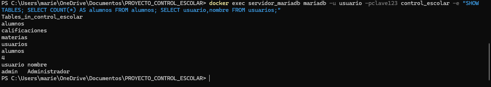
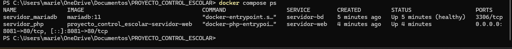
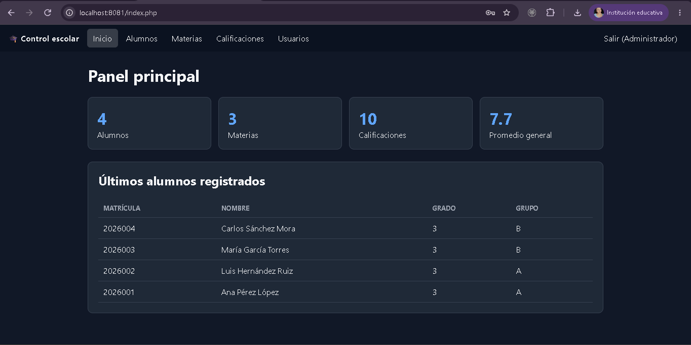
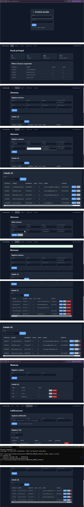
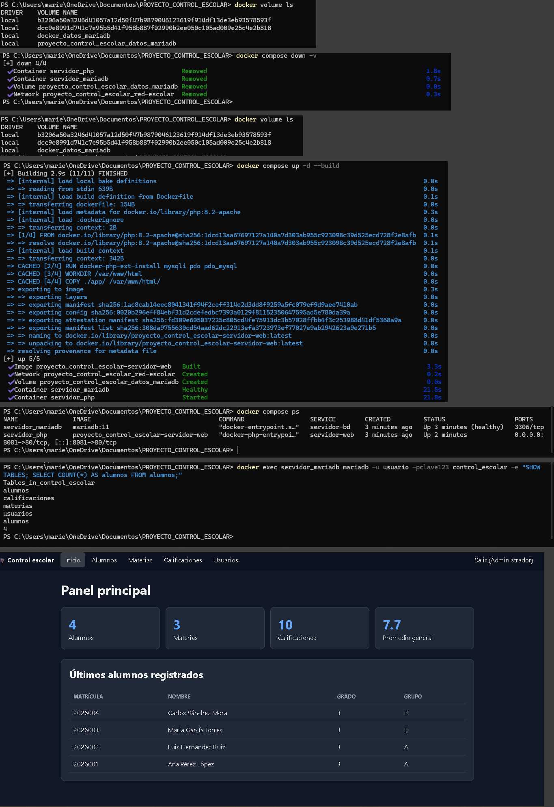

# Migración y despliegue de un Sistema de Control Escolar mediante Docker Compose

## 1. Portada

**Universidad Tecnológica de Puebla**
**Automatización de la Infraestructura Digital II**
**Integrantes del equipo:**
- Mariel Cortes Zavaleta
- Evan Zuriel Ramirez Robles

**Docente:** Joaquin Irigoyen Bautista
**Fecha:** 18 de noviembre de 2026

---

## 2. Introducción

El Sistema de Control Escolar es una aplicación web desarrollada en PHP que guarda su información en una base de datos MariaDB. Con ella se puede iniciar sesión con una cuenta de usuario, administrar alumnos (darlos de alta, buscarlos, consultarlos, modificarlos y eliminarlos), administrar materias, capturar y consultar calificaciones con su promedio, y gestionar las cuentas que tienen acceso al sistema, incluyendo altas, bajas y cambios de contraseña.

Normalmente una aplicación de este tipo se instala directamente en Windows, con PHP, Apache y MariaDB configurados uno por uno, por ejemplo mediante XAMPP. En este proyecto se hizo de otra manera: el sistema corre dentro de contenedores Docker, así que puede funcionar en cualquier computadora que tenga Docker instalado, sin tener que instalar ni configurar cada servicio por separado.

**Objetivo general:** migrar la aplicación a una infraestructura contenerizada con Docker Compose, de forma que la configuración de los servicios, la creación de la base de datos y la comunicación entre los componentes queden automatizadas.

---

## 3. Diagnóstico

Antes de migrar se identificaron las tecnologías, las versiones y los componentes que forman el sistema. Las versiones de PHP y de MariaDB se tomaron directamente de los contenedores en ejecución.

### Qué se encontró

El sistema no venía de una instalación tradicional en Windows. Se desarrolló desde el principio pensando en Docker y no se usó XAMPP en ningún momento. La primera versión se conectaba a un contenedor de MariaDB que ya existía, llamado `nexuss-db`, y después el equipo la reorganizó con Docker Compose.

El contenedor web ejecuta PHP 8.2.35, dato que se obtuvo con `docker exec servidor_php php -v`. La base de datos corre sobre MariaDB 11.8.9, a partir de la imagen `mariadb:11`, y se consultó con `docker exec servidor_mariadb mariadb --version`. La versión de Docker instalada en el equipo es la 29.8.2, que se verificó con `docker --version`.

En cuanto a las extensiones de PHP, la aplicación necesita `mysqli`, que fue la que se comprobó con `docker exec servidor_php php -m | findstr mysqli`. El Dockerfile instala además `pdo` y `pdo_mysql` por compatibilidad.

La base de datos se llama `control_escolar`; ese nombre aparece en la variable `MARIADB_DATABASE` y en el archivo `app/config.php`. Contiene cuatro tablas, que son `usuarios`, `alumnos`, `materias` y `calificaciones`, y se confirmaron con la instrucción `SHOW TABLES;`. El archivo que realiza la conexión es `app/config.php`, que se localizó buscando `new mysqli(` en el código. El respaldo en SQL está en `database/01_control_escolar.sql`, dentro de la carpeta `database/` del proyecto.

### Respuestas a las preguntas del diagnóstico

**¿Qué versión de PHP utiliza nuestro sistema?** PHP 8.2.35, que viene de la imagen `php:8.2-apache`.

**¿Qué versión de MariaDB utiliza?** MariaDB 11.8.9, de la imagen `mariadb:11`.

**¿Qué extensiones de PHP requiere?** Requiere `mysqli`, que se instala en el Dockerfile. Por compatibilidad se instalan también `pdo` y `pdo_mysql`.

**¿Cuál es el nombre de la base de datos?** `control_escolar`.

**¿Cuántas tablas contiene?** Cuatro: `usuarios`, `alumnos`, `materias` y `calificaciones`.

**¿Qué archivo realiza la conexión con MariaDB?** El archivo `app/config.php`.

**¿Qué información contiene nuestro respaldo SQL?** Contiene la estructura de las cuatro tablas con sus llaves primarias y foráneas, el usuario administrador y datos de ejemplo: 4 alumnos, 3 materias y 10 calificaciones.

### Respaldo

Antes de reconstruir o modificar la infraestructura, la base de datos puede respaldarse desde el contenedor con el siguiente comando:

```bash
docker exec servidor_mariadb mariadb-dump -u root -padmin123 control_escolar > respaldo_control_escolar.sql
```

Como el sistema se desarrolló directamente sobre Docker, no existía una instalación previa en Windows que hubiera que respaldar. Lo que se conserva como respaldo es una copia completa de la carpeta del proyecto en la computadora del equipo, que incluye el código de `app/` y el script `database/01_control_escolar.sql` con la estructura y los datos iniciales de la base.

**Evidencia:** `evidencias/01_diagnostico.png`


---

## 4. Arquitectura

La infraestructura final está formada por dos contenedores, una red privada y un volumen persistente, y todo se levanta con Docker Compose.

El usuario entra a la aplicación desde el navegador, ya sea en el mismo equipo o desde otra computadora de la red, usando la dirección `http://localhost:8081`. Docker toma el puerto 8081 del equipo anfitrión y lo dirige al puerto 80 del contenedor web, que es donde escucha Apache.

El primer contenedor, `servidor-web`, ejecuta Apache con PHP 8.2 y sirve el código que está en la carpeta `app/`. Es el que recibe las peticiones del navegador. El segundo, `servidor-bd`, ejecuta MariaDB y es el que almacena todos los datos. Cuando la aplicación necesita consultar o guardar información, el contenedor web se comunica con el de base de datos por el puerto 3306, y esa comunicación ocurre únicamente dentro de la red interna de Docker.

Esa red se llama `red-escolar` y es de tipo bridge, es decir, privada. Gracias a ella PHP encuentra a MariaDB simplemente por el nombre `servidor-bd`, sin necesidad de conocer su dirección IP.

Para que los datos no se pierdan, MariaDB guarda su información en un volumen llamado `datos_mariadb`, enlazado a `/var/lib/mysql`. El volumen sigue existiendo aunque el contenedor se detenga o se elimine. Por otro lado, la carpeta `database/` del proyecto se monta en `/docker-entrypoint-initdb.d`, la ruta donde la imagen de MariaDB busca los scripts SQL que debe ejecutar para inicializar la base la primera vez. Por último, la carpeta `app/` contiene el código fuente de la aplicación web, que se copia dentro de la imagen del servidor web.

---

## 5. Aplicación PHP

### Estructura del proyecto

En la carpeta principal `PROYECTO_CONTROL_ESCOLAR/` están el `Dockerfile`, el archivo `docker-compose.yml` y este documento, `DOCUMENTACION.md`. A partir de ahí el proyecto se divide en tres carpetas.

- `app/` contiene el código de la aplicación: `alumnos.php`, `calificaciones.php`, `config.php`, `index.php`, `layout.php`, `login.php`, `logout.php`, `materias.php` y `usuarios.php`.
- `database/` contiene el script `01_control_escolar.sql`.
- `evidencias/` guarda las capturas de pantalla, numeradas de `01_diagnostico.png` a `08_reconstruccion.png`.

### Qué hace cada archivo de la aplicación

El archivo `config.php` es el corazón de la parte técnica: abre la conexión con MariaDB y define las funciones de seguridad, como el manejo de la sesión, el token CSRF y los mensajes que se muestran al usuario. El archivo `layout.php` guarda lo que se repite en todas las pantallas, es decir, el encabezado, el menú de navegación y los estilos.

Los archivos `login.php` y `logout.php` se encargan de iniciar y cerrar la sesión. Una vez dentro, `index.php` presenta el panel principal con los totales y los últimos alumnos registrados. El archivo `alumnos.php` permite dar de alta, buscar, editar y eliminar alumnos, mientras que `materias.php` hace lo mismo con las materias. En `calificaciones.php` se capturan las calificaciones por alumno, materia y parcial, y se calcula el promedio. Finalmente, `usuarios.php` sirve para crear y eliminar usuarios del sistema y cambiar contraseñas.

### Modificaciones realizadas

**Archivo de conexión (`app/config.php`)**

En la versión inicial la aplicación se conectaba al contenedor `nexuss-db` usando el usuario root:

```php
const DB_HOST = 'nexuss-db';
const DB_PORT = 3306;
const DB_USER = 'root';
const DB_PASS = 'rootpass';
const DB_NAME = 'control_escolar';
```

Con Docker Compose quedó así:

```php
const DB_HOST = 'servidor-bd';
const DB_PORT = 3306;
const DB_USER = 'usuario';
const DB_PASS = 'clave123';
const DB_NAME = 'control_escolar';
```

**Explicación del cambio:** dentro de una red de Docker, cada contenedor se localiza por el nombre de su servicio. Por eso el host ahora es `servidor-bd`, que es el nombre del servicio de MariaDB en Docker Compose. No se puede usar `localhost`, porque dentro del contenedor de PHP `localhost` se refiere al propio contenedor de PHP, y ahí no existe ninguna base de datos. El usuario y la contraseña son los que se definieron en las variables `MARIADB_USER` y `MARIADB_PASSWORD`, así que la aplicación dejó de trabajar con la cuenta root, lo cual es más seguro.

**Otros cambios:** en la versión inicial, PHP creaba la base de datos y las tablas la primera vez que alguien abría la aplicación. Ahora esa tarea la hace el script `database/01_control_escolar.sql`, que MariaDB ejecuta por sí sola al inicializarse. Por eso `config.php` ya solo se encarga de conectarse a la base.

---

## 6. Base de datos

### Tablas

La base `control_escolar` tiene cuatro tablas. La tabla `usuarios` guarda las cuentas de acceso al sistema, con la contraseña cifrada. La tabla `alumnos` almacena los datos personales de cada alumno junto con su grado y grupo. La tabla `materias` es el catálogo de materias, organizado por grado. Estas tres tienen como llave primaria el campo `id` y no dependen de otras tablas.

La cuarta, `calificaciones`, es la que relaciona a las demás: guarda la calificación de un alumno en una materia y en un parcial determinado. También usa `id` como llave primaria, pero además tiene dos llaves foráneas: `alumno_id`, que apunta a `alumnos(id)`, y `materia_id`, que apunta a `materias(id)`.

Estas llaves foráneas usan `ON DELETE CASCADE`, lo que significa que si se elimina un alumno o una materia, también se eliminan sus calificaciones y no quedan registros huérfanos. Además, la combinación de alumno, materia y parcial es única, para evitar que una misma calificación se capture dos veces.

### Respaldo SQL

El archivo `database/01_control_escolar.sql` contiene las instrucciones `CREATE TABLE` de las cuatro tablas y los `INSERT INTO` con los datos iniciales: el usuario administrador, 4 alumnos, 3 materias y 10 calificaciones.

Para que el script funcione bien dentro de Docker se hicieron tres ajustes. Primero, se quitaron `CREATE DATABASE` y `USE`, porque la imagen de MariaDB ya crea y selecciona la base de datos gracias a la variable `MARIADB_DATABASE`. Segundo, las tablas se crean en un orden que respeta las llaves foráneas: primero `usuarios`, `alumnos` y `materias`, y al final `calificaciones`, que depende de las anteriores. Tercero, se eliminaron los usuarios y permisos del servidor, porque el usuario `usuario` lo crea la propia imagen a partir de `MARIADB_USER`.

**Prueba en una instancia limpia:** el script se ejecutó sobre un volumen vacío la primera vez que se levantó el proyecto y otra vez durante la prueba de reconstrucción (sección 11). En ambas ocasiones MariaDB creó las 4 tablas y cargó los 4 alumnos iniciales.

Para verificarlo se usó este comando:

```bash
docker exec servidor_mariadb mariadb -u usuario -pclave123 control_escolar -e "SHOW TABLES; SELECT COUNT(*) AS alumnos FROM alumnos; SELECT usuario,nombre FROM usuarios;"
```

**Resultado:** aparecen las tablas `alumnos`, `calificaciones`, `materias` y `usuarios`, se cuentan 4 alumnos y se muestra el usuario `admin`.

**Evidencia:** `evidencias/05_base_datos.png`



---

## 7. Dockerfile

El Dockerfile del servidor web es muy corto:

```dockerfile
FROM php:8.2-apache
RUN docker-php-ext-install mysqli pdo pdo_mysql
WORKDIR /var/www/html
COPY ./app/ /var/www/html/
```

La primera línea, `FROM php:8.2-apache`, indica que la imagen parte de la imagen oficial que ya trae Apache y PHP 8.2 integrados, así que no hay que instalarlos aparte. La segunda, `RUN docker-php-ext-install mysqli pdo pdo_mysql`, instala las extensiones que permiten a PHP conectarse a MariaDB, ya que la imagen base no las trae activadas; la aplicación usa `mysqli`, y `pdo` y `pdo_mysql` se agregan por compatibilidad. La tercera, `WORKDIR /var/www/html`, fija el directorio de trabajo, que además es la carpeta raíz de documentos de Apache. La última, `COPY ./app/ /var/www/html/`, copia el código de la aplicación dentro de la imagen.

**Función del Dockerfile:** es la receta que describe cómo construir la imagen del servidor web de manera repetible. Cualquier equipo que lo ejecute obtiene exactamente el mismo entorno.

**Evidencia:** `evidencias/02_dockerfile.png`


---

## 8. Docker Compose

Este es el archivo `docker-compose.yml` completo:

```yaml
services:
  servidor-web:
    build: .
    container_name: servidor_php
    ports:
      - "8081:80"
    depends_on:
      servidor-bd:
        condition: service_healthy
    networks:
      - red-escolar

  servidor-bd:
    image: mariadb:11
    container_name: servidor_mariadb
    environment:
      MARIADB_ROOT_PASSWORD: admin123
      MARIADB_DATABASE: control_escolar
      MARIADB_USER: usuario
      MARIADB_PASSWORD: clave123
    volumes:
      - datos_mariadb:/var/lib/mysql
      - ./database:/docker-entrypoint-initdb.d:ro
    healthcheck:
      test: ["CMD", "healthcheck.sh", "--connect", "--innodb_initialized"]
      interval: 10s
      timeout: 5s
      retries: 10
    networks:
      - red-escolar

networks:
  red-escolar:
    driver: bridge

volumes:
  datos_mariadb:
```

> Las contraseñas de este documento son solo de laboratorio. El puerto publicado es el 8081 porque el 8080 del equipo ya estaba ocupado (ver sección 12).

### Servicios

El servicio `servidor-web` se construye a partir del Dockerfile del proyecto (`build: .`) y publica el puerto 80 del contenedor en el puerto 8081 del equipo anfitrión. El servicio `servidor-bd` no se construye, sino que usa la imagen oficial `mariadb:11`; sus variables de entorno hacen que, al iniciar, se cree automáticamente la base de datos, el usuario y su contraseña.

### Variables de entorno

`MARIADB_ROOT_PASSWORD` define la contraseña del administrador (root) de MariaDB. `MARIADB_DATABASE` indica el nombre de la base de datos que se crea al inicializar. `MARIADB_USER` y `MARIADB_PASSWORD` establecen el usuario y la contraseña que utiliza la aplicación PHP.

### Redes

`red-escolar` es una red bridge privada a la que se conectan ambos contenedores. Dentro de ella se encuentran por el nombre del servicio, sin necesidad de direcciones IP. Además, el servicio de base de datos no publica el puerto 3306 hacia el exterior, de modo que solo la aplicación puede llegar a MariaDB.

### Volúmenes

El volumen `datos_mariadb:/var/lib/mysql` guarda los datos de MariaDB en un espacio administrado por Docker, por lo que sobreviven a los reinicios y a la eliminación del contenedor. La segunda línea, `./database:/docker-entrypoint-initdb.d:ro`, monta los scripts SQL en modo solo lectura dentro de la ruta que la imagen de MariaDB revisa cuando se inicializa.

### Espera a que MariaDB esté lista

Que el contenedor de PHP arranque no significa que MariaDB ya esté disponible para recibir conexiones. Para evitar errores, el servicio de base de datos define un `healthcheck` y el servicio web usa `depends_on` con la condición `service_healthy`. Así, PHP solo se inicia cuando MariaDB ya está respondiendo.

**Evidencia:** `evidencias/03_docker_compose.png`


---

## 9. Implementación

Desde la carpeta principal del proyecto, la que contiene el archivo `docker-compose.yml`, se ejecutan los siguientes comandos:

```bash
# 1. Construir la imagen e iniciar los servicios
docker compose up -d --build

# 2. Verificar los contenedores
docker compose ps

# 3. Consultar los registros
docker compose logs

# 4. Consultar los registros de MariaDB
docker compose logs servidor-bd
```

Después se abre la aplicación en el navegador. Desde el mismo equipo se usa `http://localhost:8081`. Desde otra computadora de la red local se usaría `http://IP_DEL_SERVIDOR:8081`, donde la IP se obtiene con `ipconfig`; sin embargo, al intentarlo desde otro equipo la aplicación no abrió (ver sección 12).

**Resultado:** el contenedor `servidor_mariadb` quedó en estado `healthy` y `servidor_php` quedó en ejecución, con el puerto 8081 publicado. La aplicación abre en `http://localhost:8081` y muestra el panel principal con 4 alumnos, 3 materias y 10 calificaciones.

**Evidencia:** `evidencias/04_contenedores.png`



**Evidencia:** `evidencias/06_sistema_funcionando.png`



---

## 10. Pruebas

Se hicieron diez pruebas para comprobar que el sistema funciona y que los datos se conservan. Todas pasaron correctamente.

1. **Acceder al sistema.** Se esperaba ver la página principal y se mostró la pantalla de inicio de sesión en `localhost:8081/login.php`.
2. **Iniciar sesión.** Con el usuario `admin` y la contraseña `admin123` se entró sin problema al panel principal.
3. **Consultar alumnos.** Se esperaba ver la información y aparecieron los 4 alumnos de ejemplo.
4. **Registrar alumno.** Se registró a "Alumno Prueba" y el listado pasó de 4 a 5 alumnos.
5. **Modificar alumno.** Se cambió el grado del alumno de prueba de 9 a 10 y apareció el aviso "Alumno actualizado".
6. **Eliminar el registro de prueba.** El alumno de prueba se eliminó y el listado volvió a tener 4 alumnos.
7. **Consultar materias.** Se mostraron las 3 materias registradas.
8. **Consultar calificaciones.** Se mostraron 10 registros con el alumno y la materia de cada uno, con un promedio de 7.72.
9. **Reiniciar contenedores.** Con `docker compose restart` se reiniciaron ambos contenedores y el sistema volvió a abrir.
10. **Consultar la información después del reinicio.** Tras el reinicio se siguieron mostrando los 4 alumnos, lo que confirma que los datos permanecen.

Para las pruebas 9 y 10 se utilizó el comando:

```bash
docker compose restart
```

**Evidencia:** `evidencias/07_pruebas.png` (pruebas 1 a 10, en orden)



---

## 11. Reconstrucción

Esta prueba demuestra que la infraestructura se puede eliminar por completo y volver a construir desde cero usando únicamente los archivos entregados.

```bash
# 1. Ver el estado actual y los volúmenes
docker volume ls
docker compose ps

# 2. Detener y eliminar contenedores, red y volúmenes
docker compose down -v
docker volume ls

# 3. Reconstruir
docker compose up -d --build

# 4. Comprobar contenedores, tablas y registros iniciales
docker compose ps
docker exec servidor_mariadb mariadb -u usuario -pclave123 control_escolar -e "SHOW TABLES; SELECT COUNT(*) AS alumnos FROM alumnos;"
```

**Resultado:** antes de empezar existía el volumen `proyecto_control_escolar_datos_mariadb`. Al ejecutar `docker compose down -v` se eliminaron los contenedores, la red y ese volumen, que dejó de aparecer en `docker volume ls`. Después, con `docker compose up -d --build`, se volvieron a crear la red, el volumen y los contenedores; `servidor_mariadb` quedó en estado `healthy` y MariaDB ejecutó el script SQL. Finalmente se comprobó que existen las 4 tablas, que hay 4 alumnos y que el panel muestra 4 alumnos, 3 materias y 10 calificaciones.

### ¿Por qué los scripts SQL se ejecutan cuando se crea por primera vez el volumen y no cada vez que iniciamos los contenedores?

El script de arranque de la imagen oficial de MariaDB revisa si el directorio de datos (`/var/lib/mysql`) ya contiene una base de datos inicializada. Si está vacío, crea la instancia, aplica las variables `MARIADB_*` y ejecuta, en orden alfabético, los archivos `.sql`, `.sql.gz` y `.sh` que encuentre en `/docker-entrypoint-initdb.d`. Si el directorio ya tiene datos, se salta todo ese proceso y simplemente inicia el servidor.

Como los datos viven en el volumen `datos_mariadb`, que se conserva entre reinicios, los scripts solo se ejecutan la primera vez. Para que vuelvan a ejecutarse hay que eliminar el volumen con `docker compose down -v`, lo que obliga a MariaDB a inicializarse de nuevo. Por la misma razón, si se modifica un script SQL después de la primera inicialización, el cambio no se aplica de forma automática.

**Evidencia:** `evidencias/08_reconstruccion.png`



---

## 12. Problemas

Durante el trabajo se presentaron siete problemas. Se describen en el orden en que aparecieron.

**Problema 1: archivo no encontrado al importar el esquema.** Al ejecutar `docker exec -i nexuss-db mariadb -u root -p < schema` apareció el mensaje `El sistema no puede encontrar el archivo especificado`. La causa fue doble: se escribió `schema` sin la extensión `.sql`, y además el archivo estaba en otra carpeta (OneDrive\Documentos en lugar de Documentos). Se resolvió usando el nombre completo `schema.sql`, comprobando su ubicación con `dir schema*` y ejecutando el comando desde la carpeta correcta.

**Problema 2: el operador `<` no funciona en PowerShell.** El error fue que el operador `<` está reservado para uso futuro (RedirectionNotSupported). Ocurrió porque la terminal era PowerShell, que no admite la redirección `<` que sí funciona en CMD. La solución fue usar `Get-Content schema.sql -Encoding UTF8 | docker exec -i nexuss-db mariadb -u root -prootpass`, o bien ejecutar el comando desde `cmd`.

**Problema 3: la red y la conexión ya existían.** Aparecieron los mensajes `network with name escuela already exists` y `endpoint with name nexuss-db already exists in network escuela`. La causa es que la red y la conexión se habían creado en un intento anterior. En realidad no era un error: indicaba que la configuración ya estaba hecha, así que se continuó con el siguiente paso.

**Problema 4: `docker-compose.yml` no encontrado.** Al ejecutar `docker compose up -d --build` apareció `no configuration file provided: not found`. La terminal estaba en una carpeta que no contenía el archivo `docker-compose.yml`, porque al descomprimir el zip se había creado una carpeta dentro de otra. Se solucionó entrando a la carpeta correcta con `cd` y verificando con `dir` que el archivo apareciera en la lista.

**Problema 5: nombre de contenedor duplicado.** Docker mostró `The container name "/servidor_mariadb" is already in use`. Todavía había un contenedor de un intento anterior con el mismo nombre. Se eliminó con `docker rm -f servidor_mariadb servidor_php` y se repitió `docker compose up -d --build`.

**Problema 6: puerto 8080 ocupado.** El error fue `ports are not available: listen tcp 0.0.0.0:8080: bind: Only one usage of each socket address`, porque otro programa del equipo ya estaba usando el puerto 8080. Se cambió la publicación del puerto a `"8081:80"` en `docker-compose.yml` y se ejecutó `docker compose up -d`.

**Problema 7: el sistema no abre desde otro equipo de la red.** Al entrar a `http://IP_DEL_SERVIDOR:8081` desde otra computadora, la aplicación no abrió. La causa no se pudo confirmar; las posibilidades son que el Firewall de Windows no permita conexiones entrantes al puerto 8081 o que la red WiFi aísle los dispositivos entre sí. Se verificó la IP con `ipconfig`. Queda pendiente permitir el puerto 8081 en el Firewall mediante una regla de entrada TCP y repetir la prueba.

---

## 13. Conclusiones

En este proyecto montamos el Sistema de Control Escolar sobre una infraestructura de contenedores: uno con Apache y PHP, otro con MariaDB, una red privada para que se comuniquen y un volumen para conservar los datos. Todo se levanta con un solo comando, `docker compose up -d --build`.

La parte técnica no nos resultó difícil. El único problema importante fue que el puerto 8080 ya estaba ocupado en el equipo, y lo resolvimos cambiando la publicación del puerto a 8081 en `docker-compose.yml`. También tuvimos algunos errores de terminal, como un contenedor con nombre duplicado o comandos ejecutados en la carpeta equivocada, que quedaron documentados en la sección 12.

Aprendimos cómo el Dockerfile define la imagen del servidor web, cómo Docker Compose conecta los servicios entre sí y por qué la aplicación debe usar el nombre del servicio `servidor-bd` en lugar de `localhost`. También comprobamos que los scripts SQL de la carpeta `database/` solo se ejecutan cuando el volumen está vacío, y por eso la reconstrucción con `docker compose down -v` vuelve a crear la base de datos con sus datos iniciales.

La principal ventaja de esta infraestructura es la reproducibilidad: cualquier equipo con Docker puede levantar el sistema con los mismos archivos, sin instalar PHP, Apache ni MariaDB. Como limitaciones, las contraseñas de laboratorio están escritas directamente en el código y en el archivo de Compose, y no logramos abrir el sistema desde otro equipo de la red. Como mejoras, revisaríamos el Firewall y usaríamos variables de entorno para guardar las credenciales.
