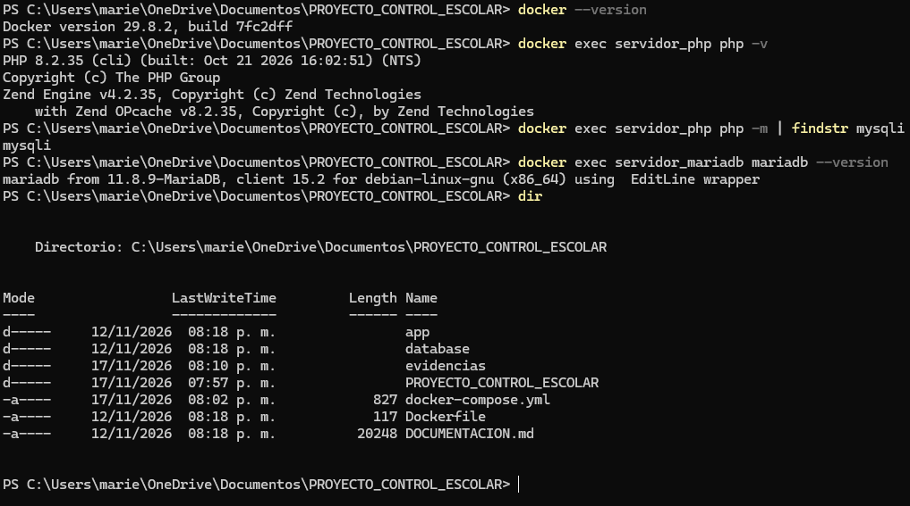
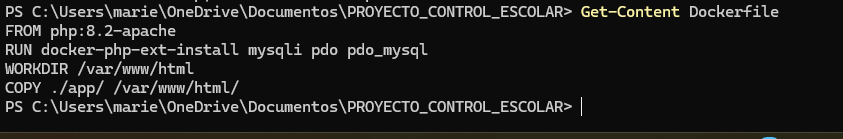
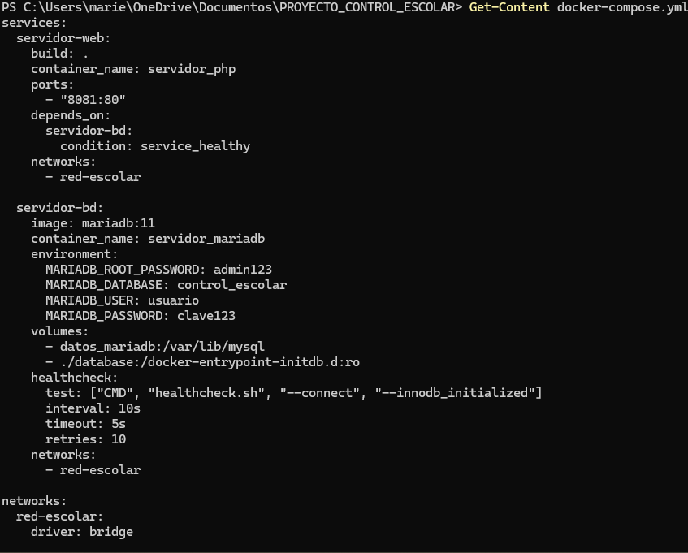

# Migración y despliegue de un Sistema de Control Escolar mediante Docker Compose

## 1. Portada

**Institución:** Universidad Tecnológica de Puebla
**Asignatura:** Automatización de la Infraestructura Digital II
**Integrantes:**
- Mariel Cortes Zavaleta
- Evan Zuriel Ramirez Robles

**Docente:** Joaquin Irigoyen Bautista
**Fecha:** 18 de noviembre de 2026

---

## 2. Introducción

El Sistema de Control Escolar es una aplicación web desarrollada en PHP con base de datos MariaDB. Incluye los siguientes módulos:

- Inicio de sesión de usuarios.
- Gestión de alumnos (alta, búsqueda, consulta, modificación y baja).
- Gestión de materias.
- Captura y consulta de calificaciones, con promedio.
- Gestión de usuarios del sistema (alta, baja y cambio de contraseña).

Tradicionalmente este tipo de aplicaciones se instala con PHP, Apache y MariaDB directamente en Windows (por ejemplo, con XAMPP). En este proyecto el sistema se ejecuta en una infraestructura de contenedores Docker, de modo que puede funcionar en cualquier computadora con Docker sin instalar ni configurar cada servicio por separado.

**Objetivo general:** migrar la aplicación a una infraestructura contenerizada con Docker Compose, automatizando la configuración de los servicios, la creación de la base de datos y la comunicación entre componentes.

---

## 3. Diagnóstico

Se identificaron las tecnologías, versiones y componentes del sistema. Las versiones de PHP y MariaDB se obtuvieron de los contenedores en ejecución.

| Elemento | Valor encontrado | Cómo se obtuvo |
|---|---|---|
| Entorno original | Desarrollado directamente para Docker; no se usó XAMPP previamente. La primera versión se conectaba a un contenedor MariaDB existente (`nexuss-db`) y después se reorganizó con Docker Compose. | Explicación del equipo |
| Versión de PHP | 8.2.35 | `docker exec servidor_php php -v` |
| Versión de MariaDB | 11.8.9 (imagen `mariadb:11`) | `docker exec servidor_mariadb mariadb --version` |
| Versión de Docker | 29.8.2 | `docker --version` |
| Extensiones PHP | `mysqli` (el Dockerfile instala además `pdo` y `pdo_mysql`) | `docker exec servidor_php php -m \| findstr mysqli` |
| Base de datos | `control_escolar` | Variable `MARIADB_DATABASE` y `app/config.php` |
| Número de tablas | 4: `usuarios`, `alumnos`, `materias` y `calificaciones` | `SHOW TABLES;` |
| Archivo de conexión | `app/config.php` | Búsqueda de `new mysqli(` en el código |
| Respaldo SQL | `database/01_control_escolar.sql` | Carpeta `database/` del proyecto |

### Respuestas a las preguntas del diagnóstico

- **¿Qué versión de PHP utiliza nuestro sistema?** PHP 8.2.35 (imagen `php:8.2-apache`).
- **¿Qué versión de MariaDB utiliza?** MariaDB 11.8.9 (imagen `mariadb:11`).
- **¿Qué extensiones de PHP requiere?** `mysqli`, que se instala en el Dockerfile. También se instalan `pdo` y `pdo_mysql` por compatibilidad.
- **¿Cuál es el nombre de la base de datos?** `control_escolar`.
- **¿Cuántas tablas contiene?** Cuatro: `usuarios`, `alumnos`, `materias` y `calificaciones`.
- **¿Qué archivo realiza la conexión con MariaDB?** `app/config.php`.
- **¿Qué información contiene nuestro respaldo SQL?** La estructura de las 4 tablas con sus llaves primarias y foráneas, el usuario administrador, 4 alumnos, 3 materias y 10 calificaciones de ejemplo.

### Respaldo

Antes de reconstruir o modificar la infraestructura, la base de datos se puede respaldar desde el contenedor con:

```bash
docker exec servidor_mariadb mariadb-dump -u root -padmin123 control_escolar > respaldo_control_escolar.sql
```

Como el sistema se desarrolló directamente para Docker, no existía una instalación previa en Windows que respaldar. Como respaldo se conserva una copia de la carpeta completa del proyecto en la computadora del equipo: el código (`app/`) y el script `database/01_control_escolar.sql`, que contiene la estructura y los datos iniciales de la base.

**Evidencia:** `evidencias/01_diagnostico.png`



---

## 4. Arquitectura

La infraestructura final está compuesta por dos contenedores, una red privada y un volumen persistente.

```
            Navegador (Windows / otra PC de la red)
                          |
                http://localhost:8081
                          |  puerto 8081 -> 80
+------------------------v-------------------------------------+
|              Red Docker: red-escolar                         |
|                                                              |
|  +------------------+   3306   +--------------------+        |
|  |  servidor-web    |--------->|    servidor-bd     |        |
|  | PHP 8.2 + Apache |          |      MariaDB       |        |
|  |  (carpeta app/)  |          |                    |        |
|  +------------------+          +--------------------+        |
|                                                              |
|  Volumen: datos_mariadb -> /var/lib/mysql (datos)            |
|  Carpeta: database/ -> /docker-entrypoint-initdb.d (SQL)     |
+--------------------------------------------------------------+
```

| Componente | Función |
|---|---|
| `servidor-web` | Contenedor con Apache y PHP 8.2 que ejecuta la aplicación. |
| `servidor-bd` | Contenedor con MariaDB que almacena los datos. |
| `red-escolar` | Red tipo bridge privada; permite que PHP encuentre a MariaDB por el nombre `servidor-bd`. |
| `datos_mariadb` | Volumen que guarda los datos aunque se detenga o elimine el contenedor. |
| `database/` | Scripts SQL que inicializan la base de datos la primera vez. |
| `app/` | Código fuente de la aplicación web. |

---

## 5. Aplicación PHP

### Estructura de archivos

```
PROYECTO_CONTROL_ESCOLAR/
|-- Dockerfile
|-- docker-compose.yml
|-- DOCUMENTACION.md
|-- app/
|   |-- alumnos.php
|   |-- calificaciones.php
|   |-- config.php
|   |-- index.php
|   |-- layout.php
|   |-- login.php
|   |-- logout.php
|   |-- materias.php
|   |-- usuarios.php
|-- database/
|   |-- 01_control_escolar.sql
|-- evidencias/
    |-- 01_diagnostico.png ... 08_reconstruccion.png
```

| Archivo | Función |
|---|---|
| `config.php` | Conexión a MariaDB y funciones de seguridad (sesión, token CSRF, mensajes). |
| `layout.php` | Encabezado, menú de navegación y estilos comunes. |
| `login.php` / `logout.php` | Inicio y cierre de sesión de los usuarios. |
| `index.php` | Panel principal con totales y últimos alumnos. |
| `alumnos.php` | Alta, búsqueda, edición y baja de alumnos. |
| `materias.php` | Alta, edición y baja de materias. |
| `calificaciones.php` | Captura de calificaciones por alumno, materia y parcial, con promedio. |
| `usuarios.php` | Alta y baja de usuarios y cambio de contraseña. |

### Modificaciones realizadas

**Archivo de conexión (`app/config.php`)**

Antes (versión inicial, conectada al contenedor `nexuss-db` con el usuario root):

```php
const DB_HOST = 'nexuss-db';
const DB_PORT = 3306;
const DB_USER = 'root';
const DB_PASS = 'rootpass';
const DB_NAME = 'control_escolar';
```

Después (Docker Compose):

```php
const DB_HOST = 'servidor-bd';
const DB_PORT = 3306;
const DB_USER = 'usuario';
const DB_PASS = 'clave123';
const DB_NAME = 'control_escolar';
```

**Explicación del cambio:** dentro de la red Docker cada contenedor se localiza por el nombre de su servicio. Por eso el host es `servidor-bd`, el nombre del servicio de MariaDB en Docker Compose, y no `localhost`: dentro del contenedor PHP, `localhost` es el propio contenedor PHP, donde no existe MariaDB. El usuario y la contraseña son los definidos en las variables `MARIADB_USER` y `MARIADB_PASSWORD`, de modo que la aplicación ya no usa la cuenta root.

**Otros cambios:** la versión inicial creaba la base de datos y las tablas desde PHP la primera vez que se abría. En la versión actual esa función la realiza el script `database/01_control_escolar.sql`, que MariaDB ejecuta al inicializarse. Por eso `config.php` solo se conecta a la base.

---

## 6. Base de datos

### Tablas

| Tabla | Descripción | Llave primaria | Llaves foráneas |
|---|---|---|---|
| `usuarios` | Cuentas de acceso al sistema (contraseña cifrada) | `id` | — |
| `alumnos` | Datos personales, grado y grupo de cada alumno | `id` | — |
| `materias` | Catálogo de materias por grado | `id` | — |
| `calificaciones` | Calificación por alumno, materia y parcial | `id` | `alumno_id` → `alumnos(id)`; `materia_id` → `materias(id)` |

Las llaves foráneas de `calificaciones` usan `ON DELETE CASCADE`: al eliminar un alumno o una materia se eliminan también sus calificaciones. Además, la combinación alumno, materia y parcial es única, para no duplicar calificaciones.

### Respaldo SQL

El archivo `database/01_control_escolar.sql` contiene las instrucciones `CREATE TABLE` de las 4 tablas y los `INSERT INTO` iniciales: el usuario administrador, 4 alumnos, 3 materias y 10 calificaciones.

**Ajustes para que sea compatible con Docker:**

- No incluye `CREATE DATABASE` ni `USE`: la imagen de MariaDB ya crea y selecciona la base con la variable `MARIADB_DATABASE`.
- Las tablas se crean en un orden que respeta las llaves foráneas: primero `usuarios`, `alumnos` y `materias`, y al final `calificaciones`.
- No incluye usuarios ni permisos del servidor: el usuario `usuario` lo crea la propia imagen con `MARIADB_USER`.

**Prueba en una instancia limpia:** el script se ejecutó sobre un volumen vacío la primera vez que se levantó el proyecto, y de nuevo en la prueba de reconstrucción (sección 11). En ambos casos MariaDB creó las 4 tablas y cargó los 4 alumnos iniciales.

Comando usado para verificar:

```bash
docker exec servidor_mariadb mariadb -u usuario -pclave123 control_escolar -e "SHOW TABLES; SELECT COUNT(*) AS alumnos FROM alumnos; SELECT usuario,nombre FROM usuarios;"
```

**Resultado:** aparecen las tablas `alumnos`, `calificaciones`, `materias` y `usuarios`, 4 alumnos y el usuario `admin`.

**Evidencia:** `evidencias/05_base_datos.png`


---

## 7. Dockerfile

```dockerfile
FROM php:8.2-apache
RUN docker-php-ext-install mysqli pdo pdo_mysql
WORKDIR /var/www/html
COPY ./app/ /var/www/html/
```

| Instrucción | Explicación |
|---|---|
| `FROM php:8.2-apache` | Imagen base oficial que incluye Apache y PHP 8.2 ya integrados. |
| `RUN docker-php-ext-install mysqli pdo pdo_mysql` | Instala las extensiones que permiten a PHP conectarse a MariaDB; la imagen base no las trae activadas. La aplicación usa `mysqli`; `pdo` y `pdo_mysql` se instalan por compatibilidad. |
| `WORKDIR /var/www/html` | Define el directorio de trabajo, que es la raíz de documentos de Apache. |
| `COPY ./app/ /var/www/html/` | Copia la aplicación dentro de la imagen. |

**Función del Dockerfile:** es la receta que describe cómo construir la imagen del servidor web de forma repetible: cualquier equipo que lo ejecute obtiene el mismo entorno.

**Evidencia:** `evidencias/02_dockerfile.png`



---

## 8. Docker Compose

```yaml
services:
  servidor-web:
    build: .
    container_name: servidor_php
    ports:
      - "8081:80"
    depends_on:
      servidor-bd:
        condition: service_healthy
    networks:
      - red-escolar

  servidor-bd:
    image: mariadb:11
    container_name: servidor_mariadb
    environment:
      MARIADB_ROOT_PASSWORD: admin123
      MARIADB_DATABASE: control_escolar
      MARIADB_USER: usuario
      MARIADB_PASSWORD: clave123
    volumes:
      - datos_mariadb:/var/lib/mysql
      - ./database:/docker-entrypoint-initdb.d:ro
    healthcheck:
      test: ["CMD", "healthcheck.sh", "--connect", "--innodb_initialized"]
      interval: 10s
      timeout: 5s
      retries: 10
    networks:
      - red-escolar

networks:
  red-escolar:
    driver: bridge

volumes:
  datos_mariadb:
```

> Las contraseñas de este documento son solo de laboratorio. El puerto publicado es el 8081 porque el 8080 del equipo ya estaba ocupado (ver sección 12).

### Servicios

| Servicio | Explicación |
|---|---|
| `servidor-web` | Se construye con el Dockerfile (`build: .`). Publica el puerto 80 del contenedor en el 8081 del equipo anfitrión. |
| `servidor-bd` | Usa la imagen oficial `mariadb:11`. Las variables de entorno crean automáticamente la base de datos, el usuario y su contraseña. |

### Variables de entorno

| Variable | Función |
|---|---|
| `MARIADB_ROOT_PASSWORD` | Contraseña del administrador (root) de MariaDB. |
| `MARIADB_DATABASE` | Base de datos que se crea al inicializar. |
| `MARIADB_USER` / `MARIADB_PASSWORD` | Usuario y contraseña que utiliza la aplicación PHP. |

### Redes

`red-escolar` es una red bridge privada. Ambos contenedores se conectan a ella y se encuentran por el nombre del servicio, sin necesidad de direcciones IP. La base de datos no publica el puerto 3306 hacia el exterior, así que solo la aplicación puede acceder a ella.

### Volúmenes

- `datos_mariadb:/var/lib/mysql` guarda los datos de MariaDB en un volumen administrado por Docker, de modo que sobreviven a reinicios y a la eliminación del contenedor.
- `./database:/docker-entrypoint-initdb.d:ro` monta los scripts SQL en modo solo lectura en la ruta que la imagen de MariaDB revisa al inicializar.

### Espera a que MariaDB esté lista

Que el contenedor PHP arranque no garantiza que MariaDB esté disponible. Por eso el servicio de base de datos define un `healthcheck` y el servicio web usa `depends_on` con `condition: service_healthy`, de modo que PHP solo inicia cuando MariaDB ya responde.

**Evidencia:** `evidencias/03_docker_compose.png`



---

## 9. Implementación

Desde la carpeta principal del proyecto (la que contiene `docker-compose.yml`):

```bash
# 1. Construir la imagen e iniciar los servicios
docker compose up -d --build

# 2. Verificar los contenedores
docker compose ps

# 3. Consultar los registros
docker compose logs

# 4. Consultar los registros de MariaDB
docker compose logs servidor-bd
```

Después se abre la aplicación en el navegador:

- Desde el mismo equipo: `http://localhost:8081`
- Desde otra computadora de la red local: `http://IP_DEL_SERVIDOR:8081` (la IP se obtiene con `ipconfig`). Se intentó abrir el sistema desde otro equipo y no abrió (ver sección 12).

**Resultado:** `servidor_mariadb` quedó en estado `healthy` y `servidor_php` en ejecución, con el puerto 8081 publicado. La aplicación abre en `http://localhost:8081` y muestra el panel principal con 4 alumnos, 3 materias y 10 calificaciones.

**Evidencia:** `evidencias/04_contenedores.png`


**Evidencia:** `evidencias/06_sistema_funcionando.png`


---

## 10. Pruebas

| N.º | Prueba | Resultado esperado | Resultado obtenido | ¿Pasó? |
|---|---|---|---|---|
| 1 | Acceder al sistema | Página principal visible | Se muestra la pantalla de inicio de sesión en `localhost:8081/login.php`. | [x] |
| 2 | Iniciar sesión | Acceso correcto | Con `admin` / `admin123` se entra al Panel principal. | [x] |
| 3 | Consultar alumnos | Información visible | Se muestran los 4 alumnos de ejemplo. | [x] |
| 4 | Registrar alumno | Registro almacenado | Se registró "Alumno Prueba"; el listado pasó de 4 a 5. | [x] |
| 5 | Modificar alumno | Cambios guardados | Se cambió el grado de 9 a 10; apareció el aviso "Alumno actualizado". | [x] |
| 6 | Eliminar registro de prueba | Registro eliminado | El alumno de prueba se eliminó; el listado volvió a 4. | [x] |
| 7 | Consultar materias | Información visible | Se muestran las 3 materias. | [x] |
| 8 | Consultar calificaciones | Datos relacionados visibles | Se muestran 10 registros con alumno y materia; promedio 7.72. | [x] |
| 9 | Reiniciar contenedores | Sistema sigue funcionando | `docker compose restart` reinició ambos contenedores y el sistema volvió a abrir. | [x] |
| 10 | Consultar información después del reinicio | Los datos permanecen | Tras el reinicio se muestran los 4 alumnos. | [x] |

Comando usado para las pruebas 9 y 10:

```bash
docker compose restart
```

**Evidencia:** `evidencias/07_pruebas.png` (pruebas 1 a 10, en orden)


---

## 11. Reconstrucción

Prueba de que la infraestructura se puede eliminar y reconstruir desde cero con los archivos entregados.

```bash
# 1. Ver el estado actual y los volúmenes
docker volume ls
docker compose ps

# 2. Detener y eliminar contenedores, red y volúmenes
docker compose down -v
docker volume ls

# 3. Reconstruir
docker compose up -d --build

# 4. Comprobar contenedores, tablas y registros iniciales
docker compose ps
docker exec servidor_mariadb mariadb -u usuario -pclave123 control_escolar -e "SHOW TABLES; SELECT COUNT(*) AS alumnos FROM alumnos;"
```

**Resultado:** antes de empezar existía el volumen `proyecto_control_escolar_datos_mariadb`. Con `docker compose down -v` se eliminaron los contenedores, la red y ese volumen, que dejó de aparecer en `docker volume ls`. Con `docker compose up -d --build` se volvieron a crear la red, el volumen y los contenedores; `servidor_mariadb` quedó `healthy` y MariaDB ejecutó el script SQL. Después se comprobó que existen las 4 tablas, que hay 4 alumnos y que el panel muestra 4 alumnos, 3 materias y 10 calificaciones.

### ¿Por qué los scripts SQL se ejecutan cuando se crea por primera vez el volumen y no cada vez que iniciamos los contenedores?

El script de arranque de la imagen oficial de MariaDB revisa si el directorio de datos (`/var/lib/mysql`) ya contiene una base inicializada. Si está vacío, crea la instancia, aplica las variables `MARIADB_*` y ejecuta, en orden alfabético, los archivos `.sql`, `.sql.gz` y `.sh` de `/docker-entrypoint-initdb.d`. Si el directorio ya tiene datos, omite todo ese proceso y simplemente inicia el servidor.

Como los datos viven en el volumen `datos_mariadb`, que persiste entre reinicios, los scripts solo se ejecutan la primera vez. Para que vuelvan a ejecutarse hay que eliminar el volumen (`docker compose down -v`), lo que obliga a MariaDB a inicializar de nuevo. Por esta razón, modificar un script SQL después de la primera inicialización no tiene efecto automático.

**Evidencia:** `evidencias/08_reconstruccion.png`


---

## 12. Problemas

| # | Problema | Causa | Solución |
|---|---|---|---|
| 1 | `El sistema no puede encontrar el archivo especificado` al ejecutar `docker exec -i nexuss-db mariadb -u root -p < schema` | Se escribió `schema` sin la extensión `.sql`, y además el archivo estaba en otra carpeta (OneDrive\Documentos, no Documentos). | Usar el nombre completo `schema.sql`, comprobar la ubicación con `dir schema*` y ejecutar el comando desde esa carpeta. |
| 2 | El operador `<` está reservado para uso futuro (RedirectionNotSupported) | La terminal era PowerShell, que no admite la redirección `<` de CMD. | Usar `Get-Content schema.sql -Encoding UTF8 \| docker exec -i nexuss-db mariadb -u root -prootpass`, o ejecutar el comando desde `cmd`. |
| 3 | `network with name escuela already exists` y `endpoint with name nexuss-db already exists in network escuela` | La red y la conexión ya se habían creado en un intento anterior. | No es un error real: indica que la configuración ya estaba hecha; se continuó con el siguiente paso. |
| 4 | `no configuration file provided: not found` al ejecutar `docker compose up -d --build` | La terminal estaba en una carpeta que no contenía `docker-compose.yml` (el zip creó una carpeta dentro de otra). | Entrar a la carpeta correcta con `cd` y verificar con `dir` que aparezca `docker-compose.yml`. |
| 5 | `The container name "/servidor_mariadb" is already in use` | Quedaba un contenedor de un intento anterior con el mismo nombre. | Eliminarlo con `docker rm -f servidor_mariadb servidor_php` y repetir `docker compose up -d --build`. |
| 6 | `ports are not available: listen tcp 0.0.0.0:8080: bind: Only one usage of each socket address` | El puerto 8080 del equipo ya estaba en uso por otro programa. | Se cambió la publicación del puerto a `"8081:80"` en `docker-compose.yml` y se ejecutó `docker compose up -d`. |
| 7 | Al abrir `http://IP_DEL_SERVIDOR:8081` desde otro equipo de la red, la aplicación no abrió. | No se confirmó la causa. Posibles causas: el Firewall de Windows no permite conexiones entrantes al puerto 8081, o la red WiFi aísla los dispositivos entre sí. | Se verificó la IP con `ipconfig`. Queda pendiente permitir el puerto 8081 en el Firewall con una regla de entrada TCP y repetir la prueba. |

---

## 13. Conclusiones

En este proyecto montamos el Sistema de Control Escolar en una infraestructura de contenedores: un contenedor con Apache y PHP, otro con MariaDB, una red privada para que se comuniquen y un volumen para conservar los datos. Todo se levanta con un solo comando (`docker compose up -d --build`).

La parte técnica no nos resultó difícil. El único problema importante fue que el puerto 8080 ya estaba ocupado en el equipo; lo resolvimos cambiando la publicación del puerto a 8081 en `docker-compose.yml`. También tuvimos algunos errores de terminal, como un contenedor con nombre duplicado o comandos ejecutados en la carpeta equivocada, que quedaron documentados en la sección 12.

Aprendimos cómo el Dockerfile define la imagen del servidor web, cómo Docker Compose conecta los servicios y por qué la aplicación debe usar el nombre del servicio `servidor-bd` en lugar de `localhost`. También comprobamos que los scripts SQL de la carpeta `database/` solo se ejecutan cuando el volumen está vacío, y por eso la reconstrucción con `docker compose down -v` vuelve a crear la base con sus datos iniciales.

La principal ventaja de esta infraestructura es la reproducibilidad: cualquier equipo con Docker puede levantar el sistema con los mismos archivos, sin instalar PHP, Apache ni MariaDB. Como limitaciones, las contraseñas de laboratorio están escritas en el código y en el archivo de Compose, y no logramos abrir el sistema desde otro equipo de la red. Como mejoras, revisaríamos el Firewall y usaríamos variables de entorno para las credenciales.
